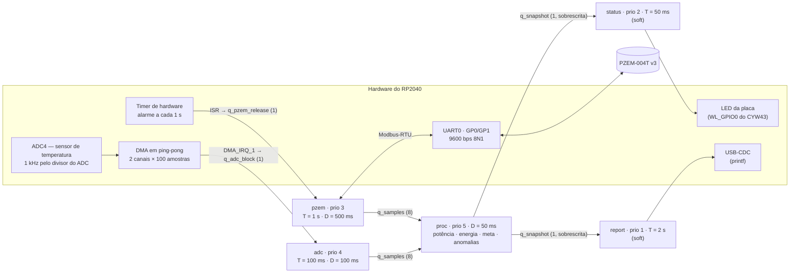
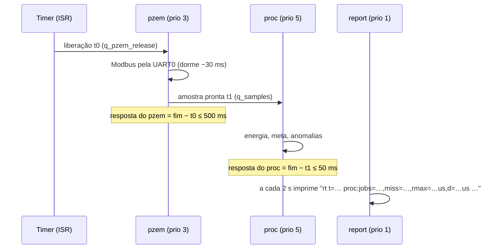

# Diagrama de tarefas — EnergyTrack WPS 3.1

Firmware `energytrack_fw` na Raspberry Pi Pico W (RP2040, um núcleo, FreeRTOS)
com o PZEM-004T v3 na UART0. A tabela abaixo é conferida automaticamente
contra `src/rt/rt_tasks.c` (teste `entregaveis.spec.test.mjs`): se alguém
mudar prioridade, período ou deadline no código sem atualizar este diagrama,
o teste quebra.

## Fluxo de dados e de liberação

- **Um dono por recurso**: só `pzem` usa a UART0, só `adc` lê os buffers do
  DMA, só `proc` mexe no estado do processamento, só `status` mexe no LED e só
  `report` escreve na USB.
- **ISR curta**: as interrupções só carimbam o instante e entregam o evento
  numa fila de 1 posição. Fila cheia = liberação perdida = estouro contado.
- **Caixa de correio**: `q_snapshot` guarda só a fotografia mais recente do
  processamento (`xQueueOverwrite`/`xQueuePeek`), sem mutex.

## Tabela de tarefas

| Tarefa | Prioridade | Período | Deadline | Orçamento de CPU | Suspensão | Tipo | Liberada por |
|---|---|---|---|---|---|---|---|
| `proc` | 5 | 100 ms | 50 ms | 4 ms | 0 ms | hard | fila de amostras (pzem e adc) |
| `adc` | 4 | 100 ms | 100 ms | 1 ms | 0 ms | hard | IRQ do DMA (bloco de 100 amostras) |
| `pzem` | 3 | 1 s | 500 ms | 3 ms | 220 ms | hard | timer de hardware (1 s) |
| `status` | 2 | 50 ms | 50 ms | 1 ms | 0 ms | soft | periódica (`xTaskDelayUntil`) |
| `report` | 1 | 2 s | 2 s | 30 ms | 0 ms | soft | periódica (`xTaskDelayUntil`) |

Interrupções e kernel (tick de 1 kHz, USB, DMA, timer, CYW43) entram na
análise como uma tarefa de prioridade máxima com 50 µs a cada 1 ms (5% da CPU).
Esse orçamento também cobre a tarefa de timers do FreeRTOS (prioridade 7), que
o port do RP2040 usa só para repassar avisos vindos de interrupção.
A tarefa `init` (prioridade 7) só existe no boot: cria filas e tarefas, liga o
DMA e o timer e se apaga.

**Por que estas prioridades**: as tarefas do critério de aceite (hard) ficam
acima das "soft"; entre as hard vale o **deadline monotônico** — deadline menor,
prioridade maior. O período do `proc` é o intervalo mínimo entre amostras da
fonte mais rápida (um bloco do ADC a cada 100 ms); o orçamento de 4 ms cobre um
bloco de ADC e uma leitura do PZEM na mesma janela.

## Prova de que cabe: análise de tempo de resposta

Prioridade fixa preemptiva, com a suspensão do `pzem` (esperando a UART)
tratada como jitter para as tarefas abaixo dele
(`R_i = C_i + S_i + Σ ⌈(R_i + J_j)/T_j⌉·C_j`, com `J_j = R_j − C_j`). Calculado
por `src/rt/rt_sched.c` sobre a tabela acima, no teste do critério AC-017
(roda no PC, não na placa):

| Tarefa | Pior tempo de resposta (R) | Deadline (D) | Folga |
|---|---|---|---|
| `proc` | 4,25 ms | 50 ms | 91% |
| `adc` | 5,3 ms | 100 ms | 95% |
| `pzem` | 250,6 ms | 500 ms | 50% |
| `status` | 9,5 ms | 50 ms | 81% |
| `report` | 41,1 ms | 2 s | 98% |

Utilização total de CPU no pior caso: 13,8%.

## Como o deadline é medido na placa

Cada tarefa tem um `rt_monitor_t` (`src/rt/rt_monitor.c`): tempo de resposta =
término − liberação; acima do deadline, ou liberação perdida, conta `miss`.
Depois de 10 min com `miss=0` nas três tarefas hard e ≥ 95% de leituras válidas
do PZEM, o relatório imprime `>>> RT PASS <<<`.
