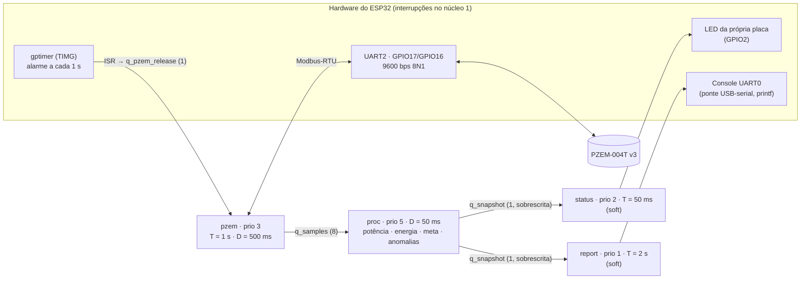

# Diagrama de tarefas — EnergyTrack WPS 3.1

Firmware `energytrack_fw` no ESP32 DevKit (ESP32-WROOM-32, FreeRTOS do
ESP-IDF) com o PZEM-004T v3 na UART2. Todas as tarefas e interrupções do
firmware ficam presas no **núcleo 1** (APP_CPU); o núcleo 0 fica com o
sistema. Por isso a análise abaixo é de um núcleo só. A tabela abaixo é
conferida automaticamente contra `src/rt/rt_tasks.c` (teste
`entregaveis.spec.test.mjs`): se alguém mudar prioridade, período ou deadline
no código sem atualizar este diagrama, o teste quebra.

## Fluxo de dados e de liberação

- **Um dono por recurso**: só `pzem` usa a UART2, só `proc` mexe no estado do
  processamento, só `status` mexe no LED e só `report` escreve no console.
- **ISR curta**: a interrupção do timer só carimba o instante e entrega a
  liberação numa fila de 1 posição. Fila cheia = liberação perdida = estouro contado.
- **Caixa de correio**: `q_snapshot` guarda só a fotografia mais recente do
  processamento (`xQueueOverwrite`/`xQueuePeek`), sem mutex.

## Tabela de tarefas

| Tarefa | Prioridade | Período | Deadline | Orçamento de CPU | Suspensão | Tipo | Liberada por |
|---|---|---|---|---|---|---|---|
| `proc` | 5 | 500 ms | 50 ms | 4 ms | 0 ms | hard | fila de amostras do pzem |
| `pzem` | 3 | 1 s | 500 ms | 3 ms | 220 ms | hard | timer de hardware (1 s) |
| `status` | 2 | 50 ms | 50 ms | 1 ms | 0 ms | soft | periódica (`xTaskDelayUntil`) |
| `report` | 1 | 2 s | 2 s | 30 ms | 0 ms | soft | periódica (`xTaskDelayUntil`) |

Interrupções e kernel do núcleo 1 (tick de 1 kHz, UARTs do PZEM e do console,
gptimer) entram na análise como uma tarefa de prioridade máxima com 50 µs a
cada 1 ms (5% da CPU). O núcleo 0 roda as tarefas do sistema do ESP-IDF
(esp_timer, IPC e, num WPS futuro, o Wi-Fi): o firmware não cria nada lá, então
elas não disputam a CPU das tarefas acima. A tarefa `init` (prioridade 10,
núcleo 1) só existe no boot: liga o console, o LED e a UART2, cria filas e
tarefas, liga o timer e se apaga. Como os drivers alocam a interrupção no
núcleo de quem os instala, é ela que garante que todas as ISRs fiquem no núcleo 1.

**Por que estas prioridades**: as tarefas do critério de aceite (hard) ficam
acima das "soft"; entre as hard vale o **deadline monotônico** — deadline menor,
prioridade maior. A prioridade 4 ficou vaga quando a tarefa `adc` saiu (o LM35
e a aquisição por ADC + DMA foram removidos em 07/11/2026). O período do `proc`
é o intervalo mínimo entre duas amostras do PZEM: elas são liberadas a cada 1 s
e ficam prontas até 500 ms depois (deadline do `pzem`), então chegam a pelo
menos 1 s − 500 ms = 500 ms uma da outra. O orçamento de 4 ms cobre uma
leitura com folga.

## Prova de que cabe: análise de tempo de resposta

Prioridade fixa preemptiva, com a suspensão do `pzem` (esperando a UART)
tratada como jitter para as tarefas abaixo dele
(`R_i = C_i + S_i + Σ ⌈(R_i + J_j)/T_j⌉·C_j`, com `J_j = R_j − C_j`). Calculado
por `src/rt/rt_sched.c` sobre a tabela acima, no teste do critério AC-017
(roda no PC, não na placa):

| Tarefa | Pior tempo de resposta (R) | Deadline (D) | Folga |
|---|---|---|---|
| `proc` | 4,25 ms | 50 ms | 91% |
| `pzem` | 239,0 ms | 500 ms | 52% |
| `status` | 8,45 ms | 50 ms | 83% |
| `report` | 40,0 ms | 2 s | 98% |

Utilização total de CPU no pior caso: 9,6%.

## Como o deadline é medido na placa

Cada tarefa tem um `rt_monitor_t` (`src/rt/rt_monitor.c`): tempo de resposta =
término − liberação; acima do deadline, ou liberação perdida, conta `miss`.
Depois de 10 min com `miss=0` nas duas tarefas hard (`proc` e `pzem`) e ≥ 95%
de leituras válidas do PZEM, o relatório imprime `>>> RT PASS <<<`.
